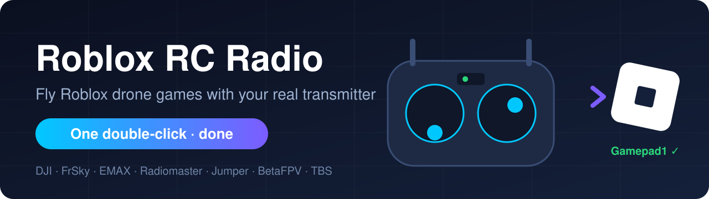
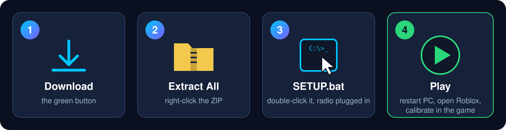

  

  

  <b>Came here from a Roblox game?</b> You're in the right place. Takes 1 minute. 🚁 
  <a href="#-en-español">🇪🇸 ¿Hablas español? Instrucciones aquí abajo</a>

---

## ⚡ How to connect your radio

  

| | Do this | |
|:-:|---|---|
| **1** | Click the green **[⬇ DOWNLOAD](https://github.com/JRXsec/roblox-rc-radio/archive/refs/heads/main.zip)** button | 📥 |
| **2** | Open your *Downloads* folder → **right-click** `roblox-rc-radio-main.zip` → **Extract All…** → **Extract** | 📂 |
| **3** | Plug your radio into the PC by USB (choose **USB Joystick / HID** if it asks) and **double-click `SETUP.bat`** | 🎮 |
| **4** | **Restart your PC**, open the Roblox game and calibrate your radio in its settings | ✅ |

That's it. You only do this **once**, and it keeps working after Roblox updates.

> [!WARNING]
> **Blue window "Windows protected your PC"?** That's normal for any `.bat` file.
> Click **More info** → **Run anyway**.
> The files are plain text: right-click → *Edit* and you can read every line.

> [!TIP]
> **More than one radio?** Plug in the next one and double-click `SETUP.bat` again. Every radio is kept.

### 🛟 Something's not working?

| Problem | Fix |
|---|---|
| *"No radio found"* | The radio is off or not in joystick mode. On DJI, FrSky, EMAX, Radiomaster…: plug in USB and pick **USB Joystick (HID)**. Then run `SETUP.bat` again. |
| Roblox still ignores the radio | Restart the PC. Roblox only reads the setting when it starts fresh. |
| *"setup-radio.ps1 is missing"* | You opened `SETUP.bat` from inside the ZIP. Do step **2** (Extract All) first. |
| Sticks move the wrong way | Calibrate the radio inside the game. Every radio orders its channels differently. |

### ❌ Uninstall

Double-click **`UNINSTALL.bat`**. Done.

---

## 🇪🇸 En español

**¿Vienes de un juego de Roblox?** Sigue estos 4 pasos y tu emisora funcionará en Roblox. Se hace **una sola vez**.

| | Haz esto | |
|:-:|---|---|
| **1** | Pulsa el botón verde **[⬇ DESCARGAR](https://github.com/JRXsec/roblox-rc-radio/archive/refs/heads/main.zip)** | 📥 |
| **2** | Abre la carpeta *Descargas* → **clic derecho** en `roblox-rc-radio-main.zip` → **Extraer todo…** → **Extraer** | 📂 |
| **3** | Conecta la emisora por USB (elige **USB Joystick / HID** si te pregunta) y haz **doble clic en `SETUP.bat`** | 🎮 |
| **4** | **Reinicia el PC**, entra al juego de Roblox y calibra la emisora en sus ajustes | ✅ |

- **¿Sale «Windows protegió tu PC»?** Es normal con los `.bat`. Pulsa **Más información** → **Ejecutar de todas formas**.
- **¿Dice «No radio found»?** La emisora está apagada o no está en modo joystick. Cámbiala a **USB Joystick (HID)** y vuelve a abrir `SETUP.bat`.
- **¿Dice «setup-radio.ps1 is missing»?** Lo abriste dentro del ZIP. Haz primero el paso 2 (Extraer todo).
- **Para quitarlo:** doble clic en **`UNINSTALL.bat`**.

---

<b>🔍 What does it change on my PC? (it's safe)</b>

 

| | |
|---|---|
| ✅ Changes | One environment variable for your Windows user: `SDL_GAMECONTROLLERCONFIG` |
| 🚫 Doesn't touch | Roblox files, drivers, the system registry, admin rights |
| 🔄 Survives Roblox updates | Yes |
| 💻 Works on | Windows 10 / 11 |
| 🧪 Tested with | DJI FPV Remote Controller 2 (before: 0 gamepads in Roblox; after: `Gamepad1` with live sticks) |

<b>🤔 Why doesn't Roblox see my radio in the first place?</b>

 

Windows sees your radio as a game controller, but Roblox doesn't. Roblox reads controllers through the [SDL](https://www.libsdl.org/) library and only accepts devices in its built-in list ([SDL_GameControllerDB](https://github.com/mdqinc/SDL_GameControllerDB)). Xbox and PlayStation pads are on that list; RC transmitters aren't, so every Roblox game ignores them.

SDL lets you add devices through the `SDL_GAMECONTROLLERCONFIG` environment variable. This tool finds each radio you plug in and adds a mapping for it. No Roblox game can do this from inside the game, which is why you need this one-time step.

**The real fix** is Roblox including RC radios natively. If you want that too, upvote this request: [Native support for USB HID / DirectInput controllers](https://devforum.roblox.com/t/native-support-for-usb-hid-directinput-controllers-in-userinputservice/4374462).

<b>🛠️ For Roblox game developers</b>

 

Link this repo in your game description (Social Links → GitHub) so players can set up their radio.

The radio's axes become a standard gamepad: `a0..a3` go to the two thumbsticks and `a4..a5` to the triggers. The first 12 buttons go to A/B/X/Y, L1/R1, the D-pad and L3/R3. Start and Back are left unmapped on purpose, so a radio switch can't open the Roblox menu.

RC radios don't share a channel order, so your game should **calibrate**: ask the player to move each stick and use `UserInputService:GetGamepadState()` to see which axis moved and in which direction. Throttle is easy to spot because it doesn't spring back to centre.

MIT License · made for <b>Quadrift Drone Simulator</b> and every other Roblox drone game

